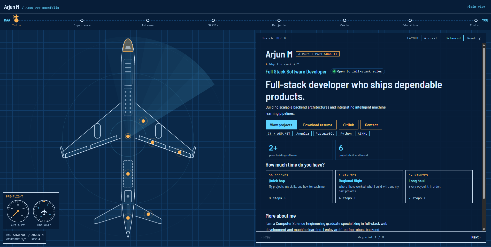
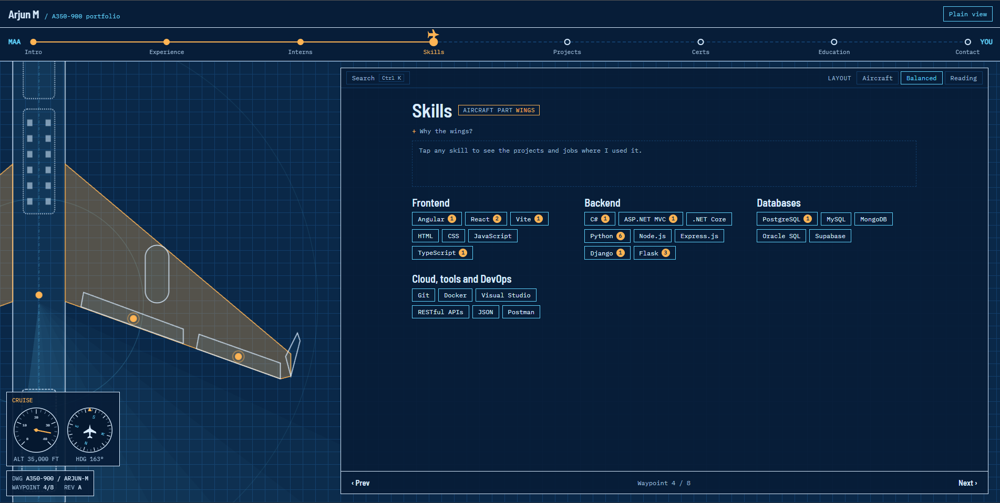
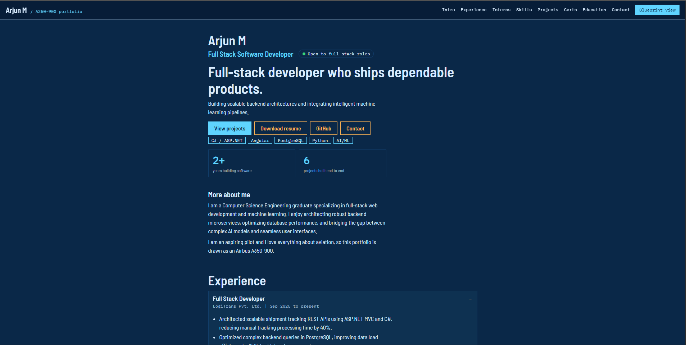
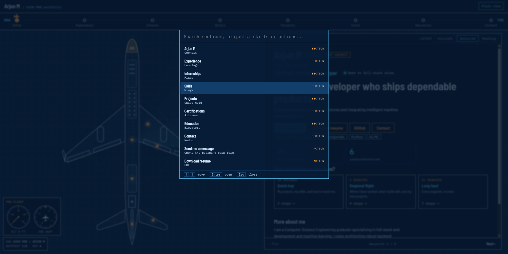
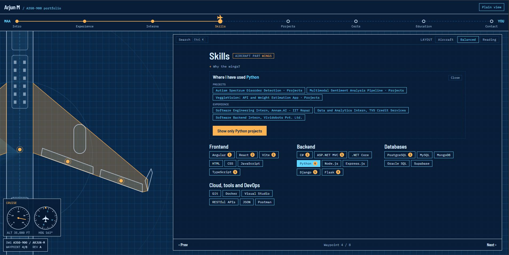
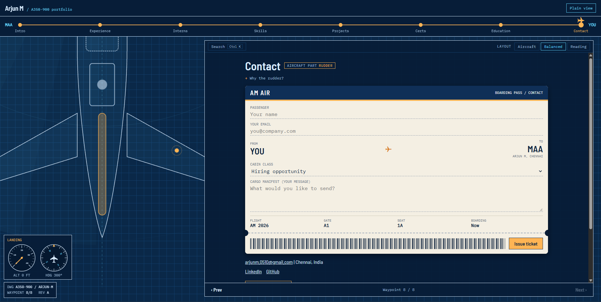
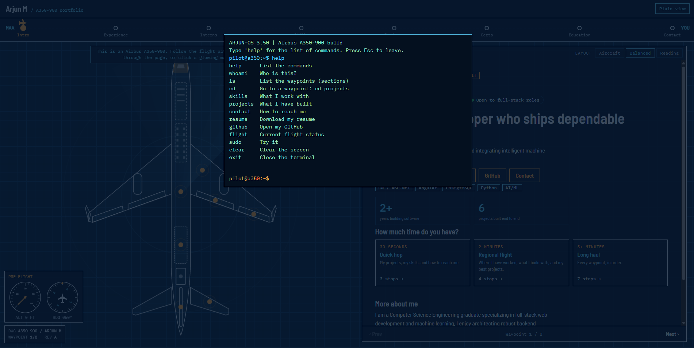
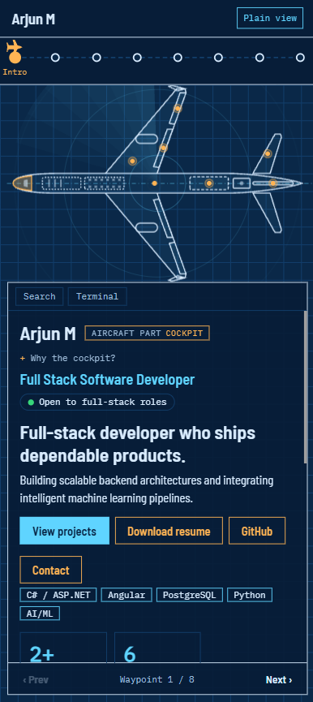

# Arjun M | Portfolio

A full-stack developer portfolio built as an **Airbus A350-900 technical blueprint**. Each part of the aircraft is a section of the portfolio: the cockpit introduces me, the wings carry my skills, the cargo hold holds my backend work, and the contact form is a boarding pass.

[](https://arjun-aircraft-portfolio.vercel.app/)

> **Live site:** [arjun-aircraft-portfolio.vercel.app](https://arjun-aircraft-portfolio.vercel.app/)
> <!-- Replace both links above (the badge and this line) with your Vercel URL. -->



The aviation theme is the personality, not the only way in. Every section is also available as a plain, text-first page, and a search palette, a guided tour and a terminal let visitors skip straight to what they came for.

---

## Highlights

**Two views, one set of content**

- **Blueprint view:** a vector A350 with clickable parts and pulsing hotspots. The camera glides to the part you choose. Scroll, click a part, use the flight-path bar or the Prev/Next buttons.
- **Plain view:** the same content as one long, accessible page with a section menu.
- **Layout choice** (Aircraft / Balanced / Reading) lets a visitor trade aircraft size for reading room.
- **Phone layout:** the aircraft turns sideways into a strip above the content, with swipe navigation.

**Built to be explored quickly**

- **Hero** with availability, a one-line pitch, key technologies and animated stats.
- **Guided tours** ("30-second hop", "2-minute regional", full "long-haul") that walk through the right sections.
- **Command palette** (`Ctrl/Cmd + K`, or `/`): search sections, projects, jobs, skills and actions.
- **Skill explorer:** pick a skill and see the projects and jobs that used it, with links to the exact cards.
- **Project filters** by technology and discipline.
- **Terminal** (press the backtick key): `help`, `whoami`, `ls`, `cd`, `skills`, `projects`, `contact`, `resume`, `github`, `flight`, `clear`, `exit`.

**Details**

- A pre-flight checklist intro, a drafting animation that "draws" the aircraft, a radar sweep, and a flight-instrument cluster (altitude, heading, phase) that follows your progress through the sections. Every animation can be switched off in config.
- Contact form styled as a boarding pass, with a validated form, a honeypot, and a visible fallback (copy message, open in mail app, profile links) if delivery fails.
- Cookie-free analytics (Umami, optional), which respects Do Not Track.
- Respects `prefers-reduced-motion`, keyboard navigation, focus states and screen-reader labels.

---

## Screenshots

|                                                                                                                                                         |                                                                                                                                                                                           |
| ------------------------------------------------------------------------------------------------------------------------------------------------------- | ----------------------------------------------------------------------------------------------------------------------------------------------------------------------------------------- |
| <br>**Blueprint view.** Click a part of the aircraft, or follow the flight path along the top. | <br>**A section in detail.** The camera zooms to the matching part while the content stays readable. |
| <br>**Plain view.** The same content as one text-first page.                                           | <br>**Command palette.** Search sections, projects, skills and actions with `Ctrl/Cmd + K`.                                    |
| <br>**Skill explorer.** Pick a skill to see the projects and jobs that used it.                | <br>**Contact form.** A boarding pass with a built-in fallback if delivery fails.                                     |
| <br>**Terminal.** Press the backtick key and type `help`.                                                  | <br>**Phone layout.** The aircraft turns sideways above the content.                                                                       |

---

## Tech stack

| Area         | Choice                                                           |
| ------------ | ---------------------------------------------------------------- |
| Framework    | [SvelteKit 2](https://svelte.dev/docs/kit) with Svelte 5 (runes) |
| Language     | TypeScript                                                       |
| Rendering    | Static site (`@sveltejs/adapter-static`), prerendered            |
| Styling      | Plain CSS with custom properties, no UI library                  |
| Graphics     | Hand-written SVG, no canvas or charting libraries                |
| Contact form | [Web3Forms](https://web3forms.com)                               |
| Analytics    | [Umami](https://umami.is) (optional)                             |
| Tests        | [Vitest](https://vitest.dev)                                     |
| Hosting      | [Vercel](https://vercel.com)                                     |

---

<!-- ## Getting started

**Requirements:** Node.js 20 or newer and npm.

```bash
git clone https://github.com/ArjunM05/aircraft-portfolio.git
cd aircraft-portfolio
npm install
cp .env.example .env     # on Windows PowerShell: Copy-Item .env.example .env
npm run dev
```

Open the address the terminal prints (usually http://localhost:5173).

### Scripts

| Command              | What it does                       |
| -------------------- | ---------------------------------- |
| `npm run dev`        | Start the development server       |
| `npm run build`      | Create the static production build |
| `npm run preview`    | Serve the production build locally |
| `npm run check`      | Type-check TypeScript and Svelte   |
| `npm test`           | Run the unit tests once            |
| `npm run test:watch` | Re-run tests on every change       |

---

## Configuration

All settings are environment variables, read in one place (`src/lib/config/app-config.ts`). Copy `.env.example` to `.env` and fill in what you need. Every variable is optional, and the site works without them.

| Variable                    | Purpose                                                                                                                                |
| --------------------------- | -------------------------------------------------------------------------------------------------------------------------------------- |
| `VITE_WEB3FORMS_ACCESS_KEY` | Delivers contact-form messages by email. Without it, the form shows the fallback options (copy message, open mail app, profile links). |
| `VITE_ANALYTICS_PROVIDER`   | Set to `umami` to turn analytics on. Leave empty to turn it off.                                                                       |
| `VITE_UMAMI_WEBSITE_ID`     | Website id from your Umami dashboard.                                                                                                  |
| `VITE_UMAMI_SCRIPT_URL`     | Umami script URL. Defaults to `https://cloud.umami.is/script.js`.                                                                      |

Variables starting with `VITE_` are baked into the public build and visible to anyone who views the page source. Web3Forms access keys are designed for browser use, but never put a private secret in a `VITE_` variable.

Site switches live in `src/lib/data/site-config.ts`:

- **Hide a section** (for example freelance or incident reports) by listing its id in `hiddenSectionIds`. It disappears from the menu, scrolling, plain view and links, while its data is still type-checked.
- **Sample badges** (`SHOW_SAMPLE_BADGES`) mark placeholder content. Turn them off once the real content is in.
- **Animations** (pre-flight intro, drafting effect, intro entrance, radar rings) can each be switched off.

---

## Project structure

```
src/
├── routes/
│   ├── +layout.svelte          header, flight-path bar, shared state wiring
│   └── +page.svelte            blueprint view, plain view, palette, terminal
└── lib/
    ├── data/                   all content and types
    │   ├── content/            one file per section (intro, backend, projects, ...)
    │   ├── profile.ts  hero.ts  demo-data.ts  telemetry-presets.ts
    │   └── site-config.ts      hidden sections, sample badges, animation switches
    ├── blueprint/              aircraft geometry, camera maths, section-to-part bindings
    ├── components/
    │   ├── sections/           one view per kind of section, plus a registry
    │   ├── extras/             optional card add-ons (telemetry, schematic, ...) and a registry
    │   └── ...                 Blueprint, FlightPath, BoardingPass, CommandPalette, ...
    ├── contact/                validation, message building, senders (Web3Forms)
    ├── navigation/             section navigator, scroll geometry, swipe, wheel handling
    ├── state/                  small state classes (active section, view mode, menu)
    ├── search/                 term matching, palette entries, skill evidence
    ├── terminal/               terminal commands
    ├── analytics/              typed events and analytics sinks
    ├── config/                 environment settings
    └── flight/                 flight-phase, altitude and heading logic
```

---

## Customising the content

Everything a visitor reads lives in `src/lib/data/`.

- **Profile and links:** `profile.ts`
- **Hero text, stats and tour routes:** `hero.ts`. The stats are marked as sample data (`statsAreSample`) until you replace them.
- **A section's content:** the matching file in `data/content/`.
- **Resume:** replace `static/resume.pdf`.

### Adding a section

1. Create `src/lib/data/content/<name>.ts` and add its type to `data/types.ts`.
2. Add it to the list in `data/content/index.ts`. Order there is menu order.
3. Add a view in `components/sections/` and register it in `section-views.ts`. TypeScript will not compile until the registry has a view for every kind of section.
4. Bind it to an aircraft part and camera position in `blueprint/section-bindings.ts`.

### Adding a card extra

Cards can carry extras such as telemetry bars, an architecture schematic or a request path. Add the type to the `CardExtra` union, create a view in `components/extras/`, and register it in `extra-views.ts`.

---

## Architecture notes

The code follows SOLID principles through small modules, not class hierarchies:

- **Registries instead of `if/else` chains:** section views and card extras are looked up by `kind`, so adding one does not mean editing existing code.
- **Small, separate state:** the active section, view mode and menu are separate classes, each provided once in the layout and read only by components that need them.
- **Swappable services:** the contact form depends on a `MessageSender` interface. Web3Forms is one implementation, and another (such as my own API) is one new file plus a branch in `contact/default-sender.ts`.
- **Pure, tested logic:** search, scrolling maths, camera easing, flight status, validation and config parsing are plain functions with unit tests.
- **Data in, not imported:** demo data and environment settings are passed to components, not imported inside them.

---

## Testing

```bash
npm test
```

Unit tests sit next to the code they cover (`*.test.ts`). They cover term matching and search, camera and scroll maths, swipe and wheel handling, flight status, contact validation and message building, the Web3Forms sender (with a faked network), configuration parsing and aircraft geometry. A content test also checks the real portfolio data: unique section ids, unique card ids (deep links depend on them), and a technology list on every project and job.

---

## Deployment

The site is hosted on [Vercel](https://vercel.com) at **[your-project.vercel.app](https://your-project.vercel.app)**  It is a static build (`@sveltejs/adapter-static`), so every push to the main branch can redeploy it automatically.

### Deploy your own copy

1. Push the repository to GitHub.
2. In Vercel, choose **Add New → Project**, import the repository, and keep the detected SvelteKit settings.
3. Under **Settings → Environment Variables**, add the `VITE_*` variables from the [Configuration](#configuration) section. They are read when the site is built, so **redeploy after changing them**.
4. Click **Deploy**. Later pushes to `main` redeploy automatically, and pull requests get preview URLs.

To check the production build locally first:

```bash
npm run build
npm run preview
```

The static output goes to `build/`. If a Vercel deployment shows a 404 page, open **Settings → Build & Development Settings** and set **Output Directory** to `build`, or switch `svelte.config.js` to `@sveltejs/adapter-vercel`, which Vercel's SvelteKit support is built around.

--- -->

## Status and roadmap

- **Sample content:** some content is placeholder and marked with "sample data" badges (hero stats, telemetry numbers, incident reports). It will be replaced with real figures.
- **Mock backend demos:** the "Try the API" shipment tracker and the live-style flight board run in the browser on mock data. They will connect to a real API (ASP.NET Core and PostgreSQL) once it is deployed. That also brings a live status tile and an own-API contact sender.

---

## Contact

- Email: <arjunm.0510@gmail.com>
- GitHub: <https://github.com/ArjunM05>
- LinkedIn: <https://www.linkedin.com/in/arjun-m-803677250/>

<!-- ## License

<choose a license, for example MIT, and add a `LICENSE` file. Without one, the code is "all rights reserved" by default.> -->
